```{r setup, include=FALSE}
# xaringanExtra::use_scribble() ## Draw on slides. Requires dev version of xaringanExtra.
library(tidyverse)
library(hrbrthemes)
library(fontawesome)
```


class: title-slide   


# ECON 525: Data Management & Visualization in Economics 

## Introduction to Machine Learning

<p align=center>
Cristhian Rosales-Castillo
</p>
<div style="margin-top: -.7cm;"></div>
<p align=center>
Emory University
</p>
<br>
<p align=center>
Fall 2026
</p>

---

# Acknowledgments

This lecture builds on course materials created by [Marcelo Ortiz Villavicencio](https://marcelortiz.com/), who previously taught ECON 525 at Emory University and generously shared his slides and code with me.

I have adapted these materials for our Fall 2026 course.

---
class: center, middle

# What is Machine Learning?

<html><div style='float:left'></div><hr color='#EB811B' size=1px width=1100px></html>

---

# AI and Machine Learning

.pull-left[
**Artificial Intelligence (AI)**

A huge set of tools for making computers behave intelligently

**Machine Learning (ML)**

An approach within AI that learns patterns from data
]

.pull-right[
<div align="center">

</div>
]

---

# Defining machine learning

A set of methods that learn patterns from data to make predictions or discover structure

Machine learning enables computers to:
- Learn patterns from existing data
- Apply those patterns to new data
- Learn a decision rule instead of relying on a rule written for every case

People still choose the algorithm, data, and learning objective.

<div align="center">

</div>

---

# What can machine learning do?
.pull-left[
**Predict outcomes**
- Will it rain tomorrow?
- Predicted chance of rain: 75%

**Identify associations**
- Which features predict rain?
- Humidity, temperature, season, etc.
- Association does not imply causation.

**Find patterns**
- Group days by weather conditions
]

.pull-right[
<div align="center">

</div>
]

---

# How does machine learning work?

Key characteristics:

- Interdisciplinary mix of statistics and computer science

- Learns a decision rule from data rather than using only hand-written rules

- Learns patterns from existing data and applies them to new data

- Relies on high-quality data


---

# Data science and machine learning

.pull-left[
**Data Science**

About discovering and communicating insights from data

**Machine Learning**

Often an important tool for data science work
]

.pull-right[
<div align="center">

</div>
]

---

# Machine learning model

A representation of patterns learned from data

For prediction, the fitted model maps input features to a predicted outcome.

<div align="center">

</div>

---

# Machine learning model: Input → Output

<div align="center">

</div>

**Example: Traffic prediction**
- Input: current traffic conditions
- Output: prediction about traffic in the next hour

---

# Machine learning model: Another example

**Example: Fake news detection**
- Input: text of a social-media post
- Output: a score for the "fake" label learned from labeled examples

Training examples pair posts with labels from a fact-checking process.

Text classification alone cannot verify whether a claim is true.

---
class: center, middle

# Types of Machine Learning

<html><div style='float:left'></div><hr color='#EB811B' size=1px width=1100px></html>

---

# Three common types of machine learning

1. **Reinforcement learning**
   - Learning which actions to take to maximize cumulative reward

2. **Supervised learning**
   - Learning from labeled data

3. **Unsupervised learning**
   - Finding patterns in unlabeled data

---

# Training data

**Training data:** existing data to learn from

**Training a model:** when a model is being built from training data
- Adjusting the model to learn patterns in the data
- Training time depends on the data, model, and computing resources

The quality and quantity of training data affect model performance.

---

# Supervised learning: Training data

<div align="center">
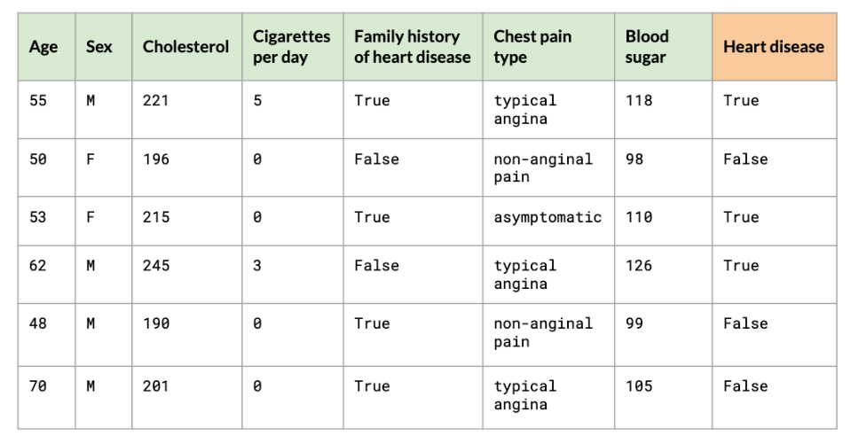
</div>

---

# Supervised learning: Target variable

<div align="center">
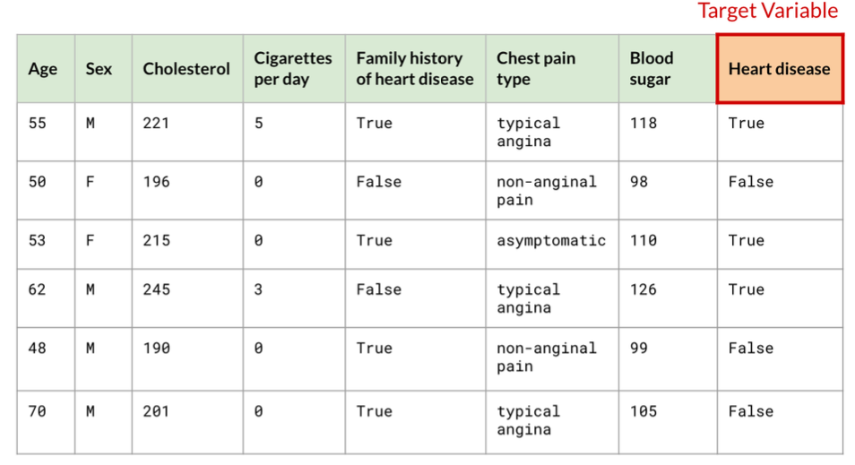
</div>

Target variable: what we want to predict (Heart disease)

**Classification** predicts a category. **Regression** predicts a number, such as a sale price.

---

# Supervised learning: Labels

<div align="center">
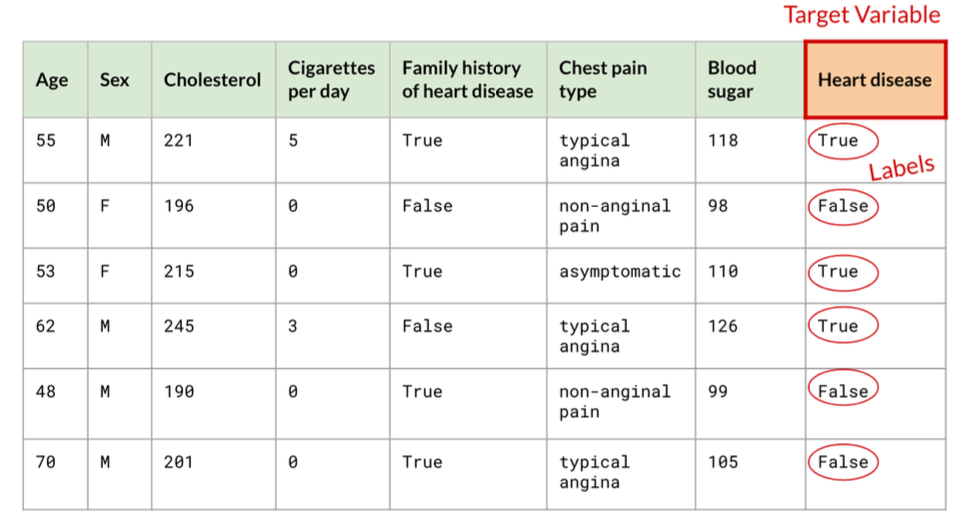
</div>

Labels: the actual values of the target variable in training data

---

# Supervised learning: Observations

<div align="center">
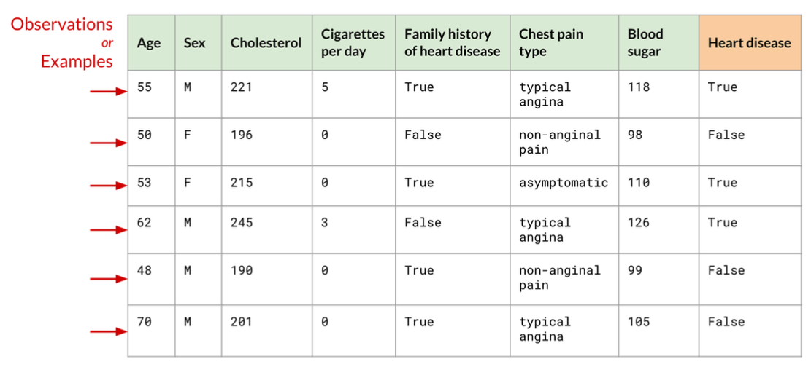
</div>

Observations (or Examples): individual rows of data

---

# Supervised learning: Features

<div align="center">
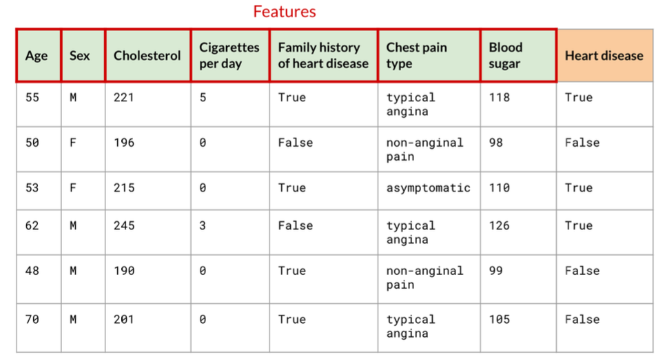
</div>

Features: input variables used to make predictions

---

# After training: Making predictions

<div align="center">
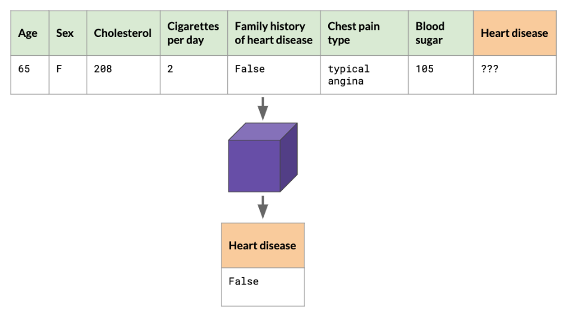
</div>

New patient data (without heart disease label) → Model → Prediction

---

# Supervised vs Unsupervised learning

.pull-left[
**Supervised learning**
- Training data is "labeled"
- Learn to predict target variable

**Unsupervised learning**
- Training data only has features
- No target variable
- Useful for:
  - Anomaly detection
  - Clustering (dividing data into groups)
]

.pull-right[
<div align="center">
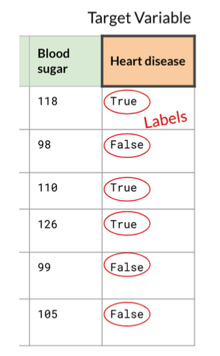
</div>
]

---

# Unsupervised learning: Example

<div align="center">
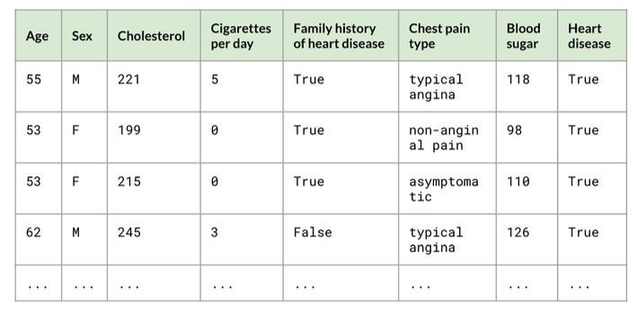
</div>

We cluster using patient features, excluding the heart-disease target column shown here.

---

# Unsupervised learning: Clustering

<div align="center">
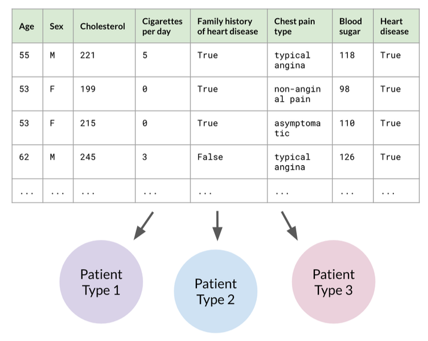
</div>

The model groups patients with similar features into clusters.

These groups are not clinical diagnoses.

---

# After training: Unsupervised learning

<div align="center">
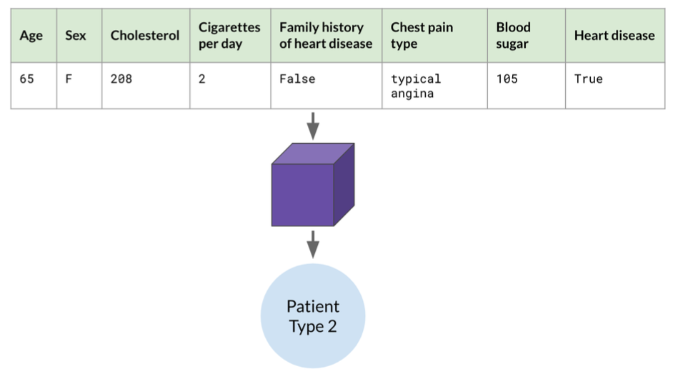
</div>

In this example, the fitted model assigns a new patient to Cluster 2.

Assigning new observations is possible with some clustering methods, such as k-means.

---

# Why unsupervised learning?

In reality, data doesn't always come with labels:

- Collecting labels can require manual work
- The outcome of interest may be unknown
- We may want to explore groups without choosing a target

Unsupervised methods explore structure without a target variable.

---
class: center, middle

# Machine Learning Workflow

<html><div style='float:left'></div><hr color='#EB811B' size=1px width=1100px></html>

---

# Our scenario: NYC property sales

.pull-left[
<div align="center">

</div>
]

.pull-right[
**Illustrative dataset:** NYC property sales from 2015-2019

**Includes:**
- Square feet
- Neighborhood
- Year built
- Sale price
- And more!

**Our target:** Sale price
]


---

# The workflow: Overview

1. **Define the task:** predict sale price using information available at prediction time.

2. **Split the data:** training data to fit, validation data to tune, and test data for final evaluation.

3. **Train and tune:** compare models using validation results.

4. **Evaluate the selected model:** use the untouched test set.

For predictions about future sales, keep later sales for evaluation.

---


# Evaluation

<div align="center">
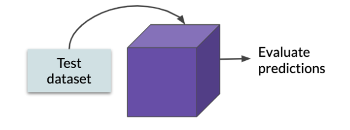
</div>

Use test dataset to evaluate model performance

Keep the test set untouched until model selection is complete.

---

# Evaluation: Is performance good enough?

<div align="center">
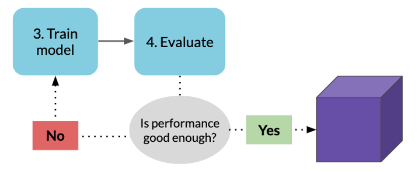
</div>

**Many ways to evaluate:**
- What is the average absolute error, in dollars?
- What share of predictions is within 10% of the actual price?

Tune and retrain with **validation data**. Evaluate the selected model on the untouched **test set**.

Compare against a baseline: the training-set median sale price.

---

# Summary: ML workflow steps

**1. Define the target and candidate features**

Use only information available at prediction time.

**2. Split dataset**

Keep training, validation, and test data separate.

**3. Prepare, train, and tune**

Fit preprocessing on training data. Tune with validation data or cross-validation.

**4. Evaluate the selected model**

Report performance on the untouched test set.

???

Cross-validation repeatedly fits and validates on portions of the training data. Fit preprocessing separately within each training fold. Source: https://scikit-learn.org/stable/modules/cross_validation.html

---

# Reinforcement learning: The basic idea

An **agent** learns which actions to take by interacting with an **environment**.

<div align="center">
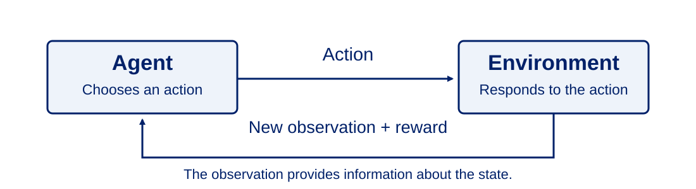
</div>

Its **policy** is the rule it uses to choose actions. The goal is to maximize **cumulative reward** over time.

???

Conceptual source: OpenAI Spinning Up, Key Concepts in RL. https://spinningup.openai.com/en/latest/spinningup/rl_intro.html

---

# Reinforcement learning: Inventory decisions

**Hypothetical example: a store learns how much stock to order each week.**

- **Agent:** the ordering system
- **Observed state:** current stock, recent demand, and pending deliveries
- **Action:** choose an order quantity
- **Reward:** sales revenue minus ordering, storage, and stockout costs

The goal is to maximize total reward across weeks. Today's order affects future stock and costs.

???

Hypothetical economic application of the agent, action, and cumulative-reward framework. https://spinningup.openai.com/en/latest/spinningup/rl_intro.html

---

# What we will cover next

Most practical work in this course will focus on **supervised learning**:

- Build and evaluate prediction models
- Tune models and track experiments
- Manage models and prepare reproducible production workflows

We introduce **unsupervised learning and reinforcement learning conceptually**, through explanations and examples.

???

Course scope reflects the material across the repository: most implemented ML exercises use supervised prediction. Unsupervised learning and RL receive conceptual introductions. The preliminary GPT notebook prepares next-character prediction targets but does not yet train a language model.

---

class: center, middle, thank-you-slide
# Thanks!


`r fa('link')` [cristhianrosalescastillo.com](https://www.cristhianrosalescastillo.com/index.html)

`r fa('envelope')` [crosal3@emory.edu](mailto:crosal3@emory.edu)

`r fa('linkedin')` [LinkedIn](https://www.linkedin.com/in/cristhian-rosales-castillo/)
