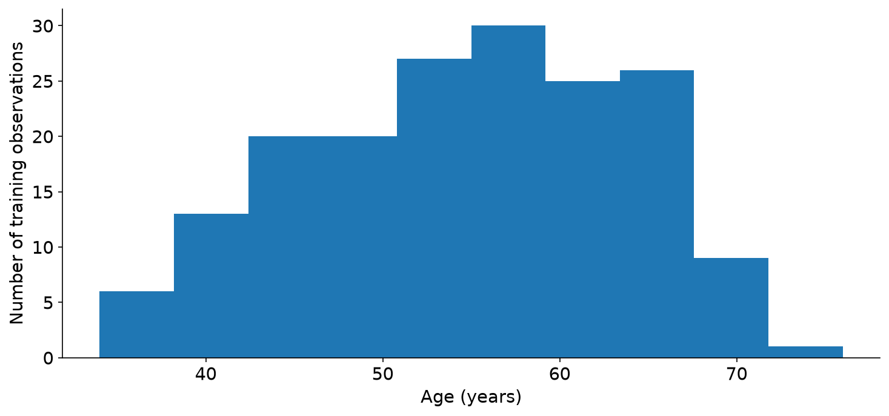
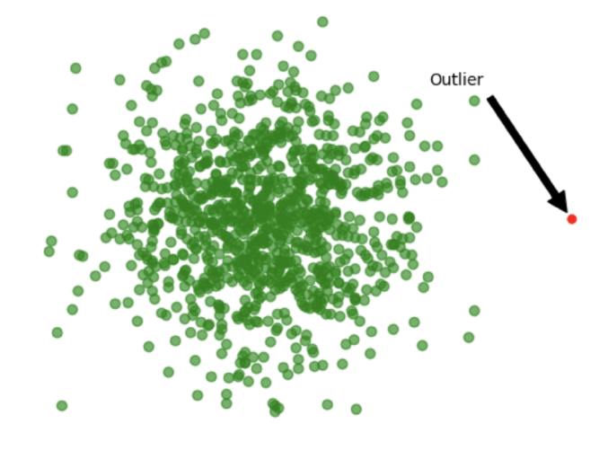
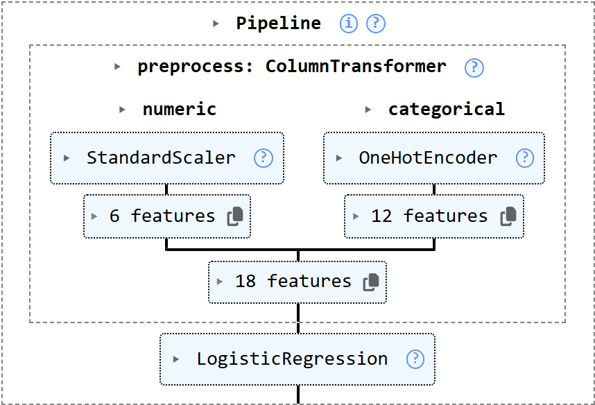

```{r setup, include=FALSE}
library(fontawesome)
```

class: title-slide

# ECON 525: Data Management & Visualization in Economics

## Classification: Design and Exploration

<p align="center">Cristhian Rosales-Castillo</p>
<p align="center">Emory University</p>
<p align="center">Fall 2026</p>

---

# Acknowledgments

This lecture builds on course materials created by [Marcelo Ortiz Villavicencio](https://marcelortiz.com/), who previously taught ECON 525 at Emory University and generously shared his slides and code with me.

Our case uses the local `heart.csv` teaching file. The [UCI Heart Disease documentation](https://archive.ics.uci.edu/dataset/45/heart+disease) describes the original data.

---

# A prediction task starts with a question

Can recorded patient measurements help distinguish the presence and absence of heart disease in this dataset?

- **One observation:** one row of patient measurements.
- **Features:** the measurements used as inputs, such as age.
- **Target:** the recorded disease status we want to predict.

This is **classification** because the outcome is a category.

The data describe recorded disease status, not the timing of a future heart attack.

---

# The model's role

.pull-left[
Before building anything, specify:

- Who would use the prediction?
- When would they use it?
- Which measurements exist then?
- What happens after an error?
]

.pull-right[
**Example:** a measurement collected during a diagnostic procedure may be unavailable at an earlier screening visit.

A useful prediction task must respect that timing.
]

This classroom model illustrates a workflow. It does not establish clinical usefulness or a causal effect.

---

# Our workflow

1. **Define:** identify the target and check its coding.
2. **Inspect:** check columns, missing values, and repeated records.
3. **Split:** reserve training, validation, and test observations.
4. **Explore and prepare:** learn patterns and preprocessing from training data.
5. **Fit and compare:** use validation results to make choices.
6. **Evaluate:** assess the chosen model once on the test set.

We will interpret the results on these slides, then reproduce the workflow together in `02-classification.ipynb`.

---

# The table we will use

The notebook reads `heart.csv` from the `05-appliedML` folder.

```python
import pandas as pd
import matplotlib.pyplot as plt

raw_data = pd.read_csv("heart.csv")
raw_data.head()
```

- `pd` is our short name for **pandas**, the table-handling library.
- `read_csv()` returns a **DataFrame**: a table with named columns.
- `raw_data` stores the original table. `head()` displays its first five rows.

We will read the results on the slides first, then run the full workflow together in the notebook.

---


# The first five records

`raw_data.head()` displays five rows. Here are selected columns from its 14-column output:

| Row | age | cp | chol | oldpeak | target |
|--:|--:|--:|--:|--:|--:|
| 0 | 63 | 3 | 233 | 2.3 | 1 |
| 1 | 37 | 2 | 250 | 3.5 | 1 |
| 2 | 41 | 1 | 204 | 1.4 | 1 |
| 3 | 56 | 1 | 236 | 0.8 | 1 |
| 4 | 57 | 0 | 354 | 0.6 | 1 |

Each row is a record, each column is a variable. The leftmost numbers are row labels, not patient measurements.

The category codes and target still need their definitions.

---

# Columns need definitions

| Column | What it records | How we use it |
|:--|:--|:--|
| `age` | Age in years | Numerical feature |
| `chol` | Serum cholesterol, mg/dL | Numerical feature |
| `cp` | A coded chest-pain category | Categorical feature |
| `oldpeak` | Exercise-related ST depression | Numerical feature |
| `target` | Recorded class, coded 0 or 1 | Outcome to predict |

The file has 303 rows and 14 columns: 13 features and one target.

**A number can be a category code.** A difference between codes 1 and 2 does not necessarily mean “one unit more.”

---

# Checking what a label means

Matching the local rows to UCI reveals reversed binary labels:

| Meaning | Local CSV `target` | Notebook `target` |
|:--|--:|--:|
| Disease absent | 1 | 0 |
| Disease present | 0 | 1 |

```python
labeled_data = raw_data.copy()
labeled_data["target"] = 1 - raw_data["target"]
```

We recode a copy, keeping the CSV unchanged. In later examples, **positive means disease present**.

.small[Sources: [UCI dictionary](https://archive.ics.uci.edu/dataset/45/heart+disease) and [original Cleveland records](https://archive.ics.uci.edu/ml/machine-learning-databases/heart-disease/processed.cleveland.data).]

---


# The recoded target

The first record's target changes from `1` in `raw_data` to `0` in `labeled_data`. Its other measurements stay the same.

| Meaning | Raw code | Recoded code | Records before cleaning |
|:--|--:|--:|--:|
| Disease absent | 1 | 0 | 165 |
| Disease present | 0 | 1 | 138 |
| **Total** | | | **303** |

We changed the coding, not the observed disease status.

`raw_data` keeps the original values; `labeled_data` is our working copy with the corrected outcome.

---

# A first data check

```python
print(labeled_data.shape)
print(labeled_data.dtypes)
print(labeled_data.isna().sum())
print(labeled_data.duplicated().sum())
```

| Check | What the result tells us |
|:--|:--|
| `shape` | Number of rows and columns |
| `dtypes` | How Python stores each column |
| `isna().sum()` | Missing entries in each column |
| `duplicated().sum()` | Exact repeats after their first occurrence |

Zero missing entries does not prove validity. A numeric code can stand for missing information without being `NaN`.

---


# What the initial checks return

| Check | Result for this file |
|:--|:--|
| `shape` | `(303, 14)`: 303 rows, 14 columns |
| `dtypes` | `oldpeak` is `float64`; the other 13 columns are `int64` |
| `isna().sum()` | All 14 column counts are `0` |
| `duplicated().sum()` | `1` exact repeated row after its first occurrence |

`float64` stores decimal numbers; `int64` stores integers. Storage type alone does not tell us whether a feature is categorical.

The zero missing counts only describe values Python recognizes as missing. We still need the codebook.

---

# Missing, unusual, and repeated values

| Observation | First response |
|:--|:--|
| An empty cholesterol entry | Investigate why it is missing |
| An unusually high cholesterol value | Check its source and units |
| A category outside the codebook | Verify the coding before changing it |
| Two identical rows | Check whether an export repeated a record |

In this file, `ca=4` and `thal=0` match missing values in UCI. The notebook excludes those records and explains that choice.

The file also contains an exact duplicate. Identical measurements alone do not prove that two rows are the same person.

---


# Preparing the teaching table

We use four named stages so we can revisit a step without changing its input:

| Table | What it contains |
|:--|:--|
| `raw_data` | The original 303 records |
| `labeled_data` | The same records with the corrected target |
| `cleaned_data` | 296 records after excluding the 7 missing-code rows |
| `data` | Those 296 records with readable column/category names |

The repeated row is among the seven excluded rows, so removing duplicates does not reduce the count again.

For example, `chol` becomes `cholesterol` and `oldpeak` becomes `st_depression`.

---

# Features and target in Python

We now separate the cleaned, renamed table into inputs and outcome:

```python
X = data.drop(columns="target")
y = data["target"]
print("X.shape:", X.shape)
print("y.shape:", y.shape)
```

- `X` is a **DataFrame** containing the input features.
- `y` is a **Series**, a single column of observed labels.
- `drop(columns=...)` returns a table without that column.

Keeping `target` inside `X` would give the model the answer it is supposed to predict.

---


# The inputs and outcome stay aligned

```text
X.shape: (296, 13)
y.shape: (296,)
```

Selected columns from the first three cleaned records:

| Row | X: age | X: cholesterol | y: target |
|--:|--:|--:|--:|
| 0 | 63 | 233 | 0 |
| 1 | 37 | 250 | 0 |
| 2 | 41 | 204 | 0 |

`X` contains 13 features for each record. `y` contains one label for the same record. Row labels keep the measurements and outcome aligned.

---

# Three sets with different jobs

| Set | Approximate share | Job |
|:--|:--|:--|
| Training | 60% | Explore and fit preprocessing/model |
| Validation | 20% | Compare choices and select a model |
| Test | 20% | Evaluate the final choice |

**Data leakage:** evaluation information influences the fitted model or the choices used to build it.

Example: a replacement mean computed from all rows lets test observations influence training.

For repeated patients, split by patient. For future predictions, consider splitting by time.

---

# Making the split

Scikit-learn (`sklearn`) supplies machine-learning tools. Its `train_test_split` function divides matching rows of `X` and `y`.

```python
from sklearn.model_selection import train_test_split

X_dev, X_test, y_dev, y_test = train_test_split(
    X, y, test_size=0.20, stratify=y, random_state=0
)
X_train, X_val, y_train, y_val = train_test_split(
    X_dev, y_dev, test_size=0.25,
    stratify=y_dev, random_state=0
)
print(len(X_train), len(X_val), len(X_test))
```

The second split reserves 25% of the remaining 80%: about **20% of all rows**.

`stratify` keeps class proportions similar. `random_state=0` makes this split reproducible; it does not make it uniquely correct.

---


# The resulting split

| Set | Number of records | Use |
|:--|--:|:--|
| Training | 177 | Explore and fit |
| Validation | 59 | Compare choices |
| Test | 60 | Final evaluation |
| **Total** | **296** | |

The first split sets aside 60 test rows, leaving 236 development rows.

The second split takes 59 of those 236 for validation, leaving 177 for training.

Percentages are approximate because a record cannot be split into fractions.

---

# Exploratory data analysis

**EDA** means using summaries and plots to understand the data before choosing a model.

We explore the **training set** to ask:

- How common is each label?
- What ranges do the measurements cover?
- Are some values missing or unusual?
- How do feature distributions differ across labels?

Patterns in this sample are associations. They do not show that changing a feature would change a patient's outcome.

---

# Class balance and a simple baseline

```python
print(y_train.value_counts())
print(y_train.value_counts(normalize=True))
```

`value_counts()` counts rows in each class. `normalize=True` returns shares that sum to 1.

**Illustration:** if 90 of 100 labels are `0`, always predicting `0` gives 90% accuracy while finding none of class `1`.

A **baseline** is a simple rule to compare against. The notebook uses the most frequent training label.

Equal class sizes are not a requirement for classification.

---


# Class balance in our training set

These are the results of the two `value_counts` calls:

| Training label | Count | Share |
|:--|--:|--:|
| 0: disease absent | 96 | 0.542373 ≈ 54.2% |
| 1: disease present | 81 | 0.457627 ≈ 45.8% |
| **Total** | **177** | **1.000000** |

The majority-label baseline learns to predict `0`. On these training labels it is correct for 96 of 177 records, yet finds none of the 81 disease cases.

We will compare models on separate validation records.

---

# A plot with a specific purpose

How wide is the range of training ages? Matplotlib (`plt`) labels and displays the histogram.

```python
X_train["age"].plot(kind="hist", bins=10)
plt.xlabel("Age (years)")
plt.ylabel("Number of training observations")
plt.show()
```

Each bar counts observations in an age interval.

The plot describes who appears in this sample. It does not tell us how common disease is in the general population.

---


# The range of training ages



**Read the result:** the training ages run from **34 to 76 years**. Taller bars contain more records in that age interval.

This is the same training split we will use in the notebook.

---

# Missing values: count before acting

```python
print(X_train.isna().sum())
print(X_train["cholesterol"].isna().any())
print(X_train["cholesterol"].isna().all())
print(X_train["cholesterol"].isna().sum())
```

`isna()` creates a table of `True`/`False` values. `sum()` counts `True` entries column by column.

| Expression on `X_train["cholesterol"]` | Meaning |
|:--|:--|
| `.isna().any()` | Is at least one entry missing? |
| `.isna().all()` | Is every entry missing? |
| `.isna().sum()` | How many entries are missing? |

The notebook renames `chol` to `cholesterol` before the split. These checks then use the new name.

---


# What the missing-value checks return

`X_train.isna().sum()` returns **0 for each of the 13 feature columns** after our cleaning rule.

For the `cholesterol` column:

| Check | Output | Interpretation |
|:--|:--|:--|
| `.isna().any()` | `False` | No entry is missing |
| `.isna().all()` | `False` | The column is not entirely missing |
| `.isna().sum()` | `0` | Zero missing entries |

Notice that `all()` is `False` even when nothing is missing. On its own, `False` would also be possible for a partly missing column.

---

# Dropping values is a decision

- **An empty row:** `dropna(how="all")` removes a row only if every entry is missing.
- **A missing target:** we cannot use that row as a labeled training example without obtaining its label.
- **A missing feature:** consider a replacement value or another documented strategy.
- **An uninformative column:** dropping it may be reasonable after checking its meaning.

Deleting every incomplete row can change who remains in the sample.

Missing labels do not automatically define a new outcome category.

---


# Imputation: a visible example

**Imputation** replaces a missing feature value with a chosen substitute. This tiny example uses illustrative cholesterol values:

```python
training_chol = pd.Series([200, 220, None])
validation_chol = pd.Series([None, 240])
mean_chol = training_chol.mean()

print(mean_chol)
print(training_chol.fillna(mean_chol).tolist())
print(validation_chol.fillna(mean_chol).tolist())
```

`None` marks a missing entry. `mean()` ignores missing entries. `fillna()` returns filled values, and `tolist()` displays them as a simple list.

We calculate the replacement from the training values only.

---


# The filled values

The three print statements return:

```text
210.0
[200.0, 220.0, 210.0]
[210.0, 240.0]
```

| Series | Before | After |
|:--|:--|:--|
| Training | 200, 220, missing | 200, 220, **210** |
| Validation | missing, 240 | **210**, 240 |

The training mean is 210. We reuse it for validation instead of learning a new replacement there.

This tiny illustration shows an alternative to excluding incomplete records.

---

# Unusual values deserve investigation

.pull-left[
An **outlier** is unusually far from other observations.

Possible explanations include:

- A unit or entry error
- A real but rare observation
- A different population

A boxplot flags values for review. It does not decide which records to delete.
]

.pull-right[

]

---

# Numerical and categorical preparation

.pull-left[
**Numerical features**

Example: age in years and cholesterol in mg/dL.

Handle any missing entries, then **scale**: express values relative to the training mean and standard deviation.

This helps models sensitive to feature scales.
]

.pull-right[
**Categorical features**

Example: chest-pain categories.

**One-hot encoding** makes indicator columns for categories.

This avoids treating category codes as a numerical distance.
]

---

# One-hot encoding: a small example

Suppose a feature has three categories: A, B, and C.

| Original category | Is B? | Is C? |
|:--|--:|--:|
| A | 0 | 0 |
| B | 1 | 0 |
| C | 0 | 1 |

With `drop="first"`, category A is the reference represented by two zeros.

The notebook learns categories from training data and reuses the same columns for validation and test observations.

---

# A pipeline keeps the steps together

A scikit-learn **Pipeline** bundles preparation and a model into one object.

`preprocess` represents the preparation just discussed: scale the six numerical features and encode the seven categorical features.

```python
from sklearn.pipeline import Pipeline
from sklearn.linear_model import LogisticRegression

model = Pipeline([
    ("preprocess", preprocess),
    ("classifier", LogisticRegression(max_iter=1000, random_state=0))
])
model.fit(X_train, y_train)
```

`fit()` learns from training data. Later, `predict()` reuses the fitted preparation and model.

---


# The fitted pipeline



The fitted object contains the learned preprocessing and classifier. Here, six numerical columns and twelve indicator columns give the classifier **18 inputs**.

Fitting returns a model object. Predictions for new rows are a separate step.

---

# Other methods solve different problems

| Method | What it does |
|:--|:--|
| Mean or median imputation | Fills missing numerical entries |
| K-nearest-neighbor imputation | Uses similar rows to fill missing entries |
| SMOTE | Creates synthetic minority-class training examples |

**SMOTE addresses class imbalance; it is not an imputation method.**

Our worked imputation example uses a simple mean. More complex methods need their own assumptions and validation, including care with categorical data.

.small[Sources: [scikit-learn imputation](https://scikit-learn.org/stable/modules/impute.html), [SMOTE documentation](https://imbalanced-learn.org/stable/references/generated/imblearn.over_sampling.SMOTE.html).]

---

# Predictions and errors

Logistic regression estimates a probability for class `1`. A threshold converts it to a class prediction.

A **confusion matrix** counts predictions by class. Rows show the actual labels, and columns show the predicted labels.

| | Predicted 0 | Predicted 1 |
|:--|:--|:--|
| **Actual 0** | True negative (TN) | False positive (FP) |
| **Actual 1** | False negative (FN) | True positive (TP) |

**Recall = TP / (TP + FN):** what share of disease cases did we find?

**Precision = TP / (TP + FP):** what share of predicted disease cases was correct?

In the notebook, we’ll build this table from predictions and compare these measures with accuracy. Estimated probabilities still need validation and calibration checks.

---

# A quick error-count puzzle

**Pairs, 3 minutes.** A hypothetical model produces:

| | Predicted 0 | Predicted 1 |
|:--|--:|--:|
| **Actual 0** | 40 | 10 |
| **Actual 1** | 20 | 30 |

1. Calculate accuracy and recall for disease (class `1`).
2. A second rule predicts `1` for everyone. What happens to recall?
3. Name one other result you would inspect before preferring that rule.

**Deliverable:** two calculations and one sentence. Be ready to explain which errors each measure counts.

---

# Takeaways

- A prediction task needs a defined target and available inputs.
- Data checks and EDA answer different questions.
- Category codes need documentation before interpretation.
- Preprocessing learns from training data only.
- Validation guides choices; the test set evaluates the final choice.
- Error counts explain what an accuracy score can hide.

.small[Further reading: [scikit-learn: common pitfalls and data leakage](https://scikit-learn.org/stable/common_pitfalls.html).]

---
class: center, middle, thank-you-slide

# Thanks!

`r fa('link')` [cristhianrosalescastillo.com](https://www.cristhianrosalescastillo.com/index.html)

`r fa('envelope')` [crosal3@emory.edu](mailto:crosal3@emory.edu)

`r fa('linkedin')` [LinkedIn](https://www.linkedin.com/in/cristhian-rosales-castillo/)
